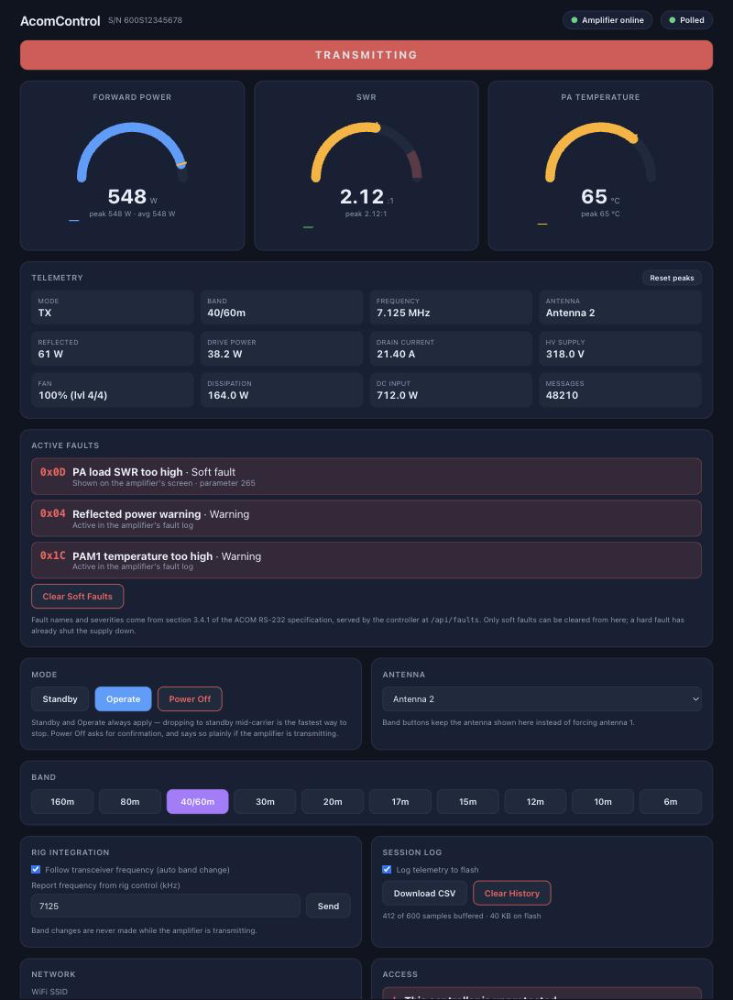

# AcomControl



The controller serves this page itself — no app required. Shown here mid-transmission
with an active soft fault, which the controller names and classifies from the
specification's own fault table.

> **Scope.** Hardware, wiring and first-run instructions here are current. The
> band codes and the API examples have been corrected for firmware 7.0, but this
> is the overview document — for the full API, including authentication,
> `/api/faults` and the fault code table, see
> [API_DOCUMENTATION.md](API_DOCUMENTATION.md), and for what changed and why see
> [CHANGELOG.md](../CHANGELOG.md).


ESP32-S3 based web interface controller for ACOM 600S RF amplifiers.

## Overview

AcomControl provides a wireless web-based interface for monitoring and controlling ACOM 600S amateur radio amplifiers. The ESP32-S3 connects to the amplifier's RS-232 serial port and provides real-time telemetry via a responsive web interface accessible from any browser.

### Features

- **Real-time Monitoring**: Forward power, reflected power, SWR, temperature, current, and input power
- **Mode Control**: Switch between Standby, Operate, and Power Off modes
- **Band Selection**: Quick band switching (160m – 6m; 60m shares the 40m filter)
- **Fault Decoding**: All 126 fault codes from the ACOM RS-232 specification,
  named and classified as warning / soft fault / hard fault
- **Hot-switching Guard**: Band and antenna changes under RF are refused unless
  the caller confirms
- **WebSocket Updates**: Low-latency real-time updates at 10Hz, with automatic
  fallback to REST polling if the socket cannot be established
- **REST API**: Full HTTP API for integration with external applications
- **Authentication**: Optional HTTP Basic across the UI, API, WebSocket and OTA
- **WiFi Connectivity**: Connect to an existing network, or use the built-in
  WPA2 access point
- **Mobile Friendly**: Responsive design works on phones, tablets, and desktops

## Hardware Requirements

- ESP32-S3 DevKit board (ESP32-S3-DevKitC-1 recommended)
- MAX3232 or similar RS-232 to TTL level converter
- ACOM 600S amplifier with RS-232 port
- DB9 serial cable or connector
- 5V power supply for ESP32 (USB or external)

## Wiring

### ESP32-S3 to RS-232 Level Converter

| ESP32-S3 | MAX3232 Module |
|----------|----------------|
| GPIO16   | RX (TTL side)  |
| GPIO17   | TX (TTL side)  |
| 3.3V     | VCC            |
| GND      | GND            |

### RS-232 Level Converter to ACOM 600S

| MAX3232 (RS-232 side) | ACOM 600S DB9 |
|-----------------------|---------------|
| TX                    | Pin 2 (RXD)   |
| RX                    | Pin 3 (TXD)   |
| GND                   | Pin 5 (GND)   |

**Note**: The ACOM 600S RS-232 port uses standard RS-232 voltage levels (±12V). A level converter is required - do not connect the ESP32 directly to the amplifier.

### Serial Configuration

- Baud Rate: 9600
- Data Bits: 8
- Parity: None
- Stop Bits: 1
- Flow Control: None

## Installation

### Prerequisites

- [PlatformIO](https://platformio.org/) IDE or CLI
- USB cable for ESP32-S3 programming

### Build and Upload

1. Clone or download the project
2. Open the project folder in PlatformIO
3. Connect the ESP32-S3 via USB
4. Build and upload:

```bash
pio run --target upload
```

5. Monitor serial output (optional):

```bash
pio device monitor
```

### First Boot

On first boot, the ESP32 creates a WiFi access point:

- **SSID**: `AcomControl`
- **Password**: None (open network)

Connect to this network and navigate to `http://192.168.4.1` to access the web interface. Use the WiFi Configuration section to connect to your home network.

## Usage

### Web Interface

Access the web interface by navigating to the ESP32's IP address in any web browser.

#### Status Display

- **Mode**: Current amplifier mode (STB, OPR, TX, etc.)
- **Band**: Selected amateur band (160m - 6m)
- **Status**: RX/TX indicator

#### Meters

- **Forward Power**: Output power in watts (0-600W)
- **Reflected Power**: Reflected power in watts
- **SWR**: Standing wave ratio
- **Temperature**: PA module temperature in °C
- **Input Power**: Drive power in watts
- **Current**: Drain current in amps

#### Controls

- **Standby**: Put amplifier in standby mode
- **Operate**: Enable amplifier for operation
- **Power Off**: Turn off the amplifier
- **Clear Errors**: Clear any soft fault errors
- **Get Info**: Request amplifier information
- **Band Buttons**: Quick band selection

## API Reference

### WebSocket

Connect to `ws://<ip-address>/ws` for real-time updates.

#### Message Format (JSON)

```json
{
  "connected": true,
  "mode": "OPR",
  "modeCode": 97,
  "band": "20m",
  "bandCode": 6,
  "isTx": false,
  "forwardPower": 0,
  "reflectedPower": 0,
  "swr": 100,
  "temperature": 303,
  "inputPower": 0,
  "current": 0,
  "frequency": 14200,
  "fanSpeed": 1,
  "hvVoltage": 480,
  "vcc5": 5100,
  "vcc26": 260,
  "pdcPower": 0,
  "disPower": 0,
  "lpfChannel": 6,
  "errorCode": 0,
  "errorParam": 0,
  "serialNumber": "A600S-001234",
  "msgCount": 1234
}
```

### REST Endpoints

#### GET /api/status

Returns current amplifier status as JSON.

#### GET /api/system

Returns system information.

```json
{
  "version": "5.0",
  "chip": "ESP32-S3",
  "freeHeap": 245760,
  "cpuFreq": 240,
  "uptime": 3600
}
```

#### POST /api/mode

Set amplifier mode.

**Request Body:**
```json
{
  "mode": 6
}
```

**Mode Values:**
- `5` - Standby
- `6` - Operate
- `10` - Power Off

#### POST /api/band

Set band and antenna.

**Request Body:**
```json
{
  "band": 6,
  "antenna": 1
}
```

**Band Values** (1–10; 60m shares the 40m filter at code 3):
- `1` - 160m
- `2` - 80m
- `3` - 40m / 60m
- `4` - 30m
- `5` - 20m
- `6` - 17m
- `7` - 15m
- `8` - 12m
- `9` - 10m
- `10` - 6m

#### POST /api/wifi

Configure WiFi credentials. Device will reboot after saving.

**Request Body:**
```json
{
  "ssid": "YourNetwork",
  "password": "YourPassword"
}
```

### Server-Sent Events

Connect to `/api/telemetry` for SSE updates at 5Hz.

## Troubleshooting

### No Connection to Amplifier

1. Verify wiring connections
2. Check that RX/TX are not swapped
3. Confirm RS-232 level converter is working
4. Ensure amplifier is powered on
5. Check serial settings (9600 8N1)

### Web Interface Not Loading

1. Verify WiFi connection
2. Check IP address (serial monitor shows IP on boot)
3. Try accessing via AP mode (192.168.4.1)

### Incorrect Readings

1. Verify the amplifier model is ACOM 600S
2. Check for firmware compatibility
3. Ensure stable power supply to ESP32

## Protocol Reference

This project implements the ACOM 600S Serial Port Communication Protocol v1.1. Key message types:

| Address | Direction | Description |
|---------|-----------|-------------|
| 0x2F    | Amp → ESP | Main telemetry (72 bytes) |
| 0x27    | Amp → ESP | Band information (17 bytes) |
| 0x21    | Amp → ESP | Error codes (24 bytes) |
| 0x11    | Amp → ESP | PCB versions/serial (30 bytes) |
| 0x81    | ESP → Amp | Commands (8 bytes) |
| 0x86    | ESP → Amp | Acknowledge (5 bytes) |
| 0x92    | ESP → Amp | Enable telemetry (4 bytes) |

## License

MIT License

Copyright (c) 2025

Permission is hereby granted, free of charge, to any person obtaining a copy
of this software and associated documentation files (the "Software"), to deal
in the Software without restriction, including without limitation the rights
to use, copy, modify, merge, publish, distribute, sublicense, and/or sell
copies of the Software, and to permit persons to whom the Software is
furnished to do so, subject to the following conditions:

The above copyright notice and this permission notice shall be included in all
copies or substantial portions of the Software.

THE SOFTWARE IS PROVIDED "AS IS", WITHOUT WARRANTY OF ANY KIND, EXPRESS OR
IMPLIED, INCLUDING BUT NOT LIMITED TO THE WARRANTIES OF MERCHANTABILITY,
FITNESS FOR A PARTICULAR PURPOSE AND NONINFRINGEMENT. IN NO EVENT SHALL THE
AUTHORS OR COPYRIGHT HOLDERS BE LIABLE FOR ANY CLAIM, DAMAGES OR OTHER
LIABILITY, WHETHER IN AN ACTION OF CONTRACT, TORT OR OTHERWISE, ARISING FROM,
OUT OF OR IN CONNECTION WITH THE SOFTWARE OR THE USE OR OTHER DEALINGS IN THE
SOFTWARE.

## Disclaimer

This project is not affiliated with or endorsed by ACOM Ltd. ACOM and ACOM 600S are trademarks of ACOM Ltd.

Use this software at your own risk. Improper use of RF amplifiers can cause interference, equipment damage, or personal injury. Always follow your local regulations and the amplifier manufacturer's guidelines.

## Author

Created for amateur radio operators (callsign: KD2NDR)

## Contributing

Contributions are welcome! Please open an issue or submit a pull request.
